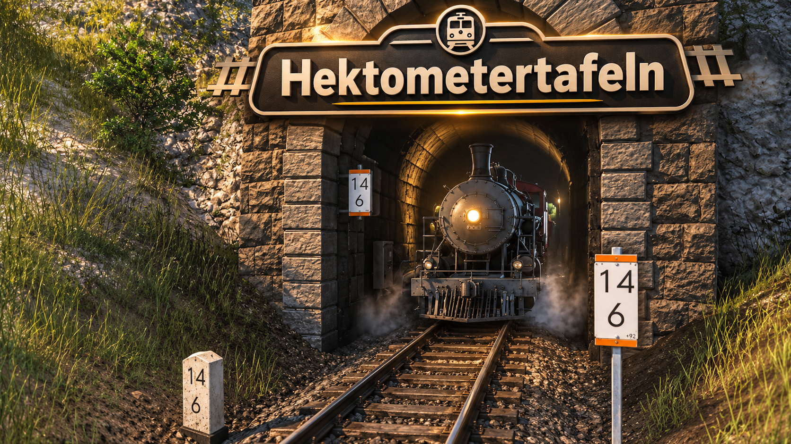

    

# Hektometertafeln (DE)

Kilometer- und Hektometertafeln für Bahngleise in Transport Fever 3: als Stein oder in mehreren Tafelformen, mit automatischem Setzen und fortlaufender Beschriftung.

## Features

- **Mehrere Designgruppen mit Varianten**
  Hektometerstein sowie Tafeln der Bauform DE|CH|AT in den Größen 610x320 und 800x480 (zweistelliger Kilometer) und 610x480 und 800x720 (dreistelliger Kilometer). Die Tafeln gibt es mit Mast, mit Wandhalterung oder ohne Halterung, optional mit Reflektor. Die Anzeige lässt sich einseitig oder beidseitig wählen: Bei beidseitiger Anzeige sind die Ziffern auf Vorder- und Rückseite lesbar.
- **Automatisch setzen mit Weiterzählen**
  Beim Setzen einer Tafel wählst du einen Abstand (100 bis 1000 m). Die Mod setzt entlang des Gleises in Pfeilrichtung weitere Tafeln und zählt Kilometer und Hektometer vom Startwert weiter. An Weichen folgt das Setzen dem geradesten Gleis. Es endet am Gleisende, vor der nächsten Tafel auf derselben Seite und beim Höchstwert von 99,9 km (dreistellig 999,9 km). Auf Bahnhofsgleisen werden keine Tafeln gesetzt, die Zählung läuft dahinter weiter. Lehnt das Spiel eine Tafel ab, weicht die Mod um bis zu 15 m aus; mit aktiver Meteranzeige passen sich die Meterwerte an. Jede Tafel wird passend benannt, zum Beispiel "Hektometertafel 12,600".
- **Höhe und Versatz wählbar**
  Tief, Default oder Hoch (Hoch nur bei Wandhalterung und ohne Halterung), dazu die Seite, Abstand zur Gleismitte (1,8 bis 3,4 m) und Versatz (±1,5 m).
- **Negative Werte**
  Als erste Stelle kann ein Minus gewählt werden, zum Beispiel für Strecken mit negativer Kilometrierung. Auch Auto-Setzen zählt damit weiter.
- **Meter-genaue Angaben**
  Bei den Tafeln lässt sich zusätzlich eine zweistellige Meteranzeige unten rechts einblenden.

### Hinweis zur KI Nutzung
Bei einzelnen kleineren Teilbereichen der Entwicklung (z. B. Code-Hilfe oder Textformulierung) kam unterstützend KI (Microsoft Copilot) zum Einsatz. Das Titelbild (basierend auf einem eigenen Screenshot) sowie das Logo wurden mithilfe von ChatGPT erstellt.

### Fehler melden

Bugs oder Features können auf GitHub oder Mod.io gemeldet werden.

- [GitHub](https://github.com/Peppie84/tpf3-Hectometermarker) https://github.com/Peppie84/tpf3-Hectometermarker
- mod.io tpd

### Changelog

- **v1.1.0 (Rev2)** (19.04.2026) 
  - Texturen wurden einheitlich auf 1024 
    angepasst 
  - Unvorhergesehener Konflikt beim Auto- 
    Setzen mit einer anderen Mod wurde 
    behoben 
  - Tooltips bei allen Optionen gesetzt 
  - Feature: Zusätzlicher Stopp beim Auto- 
    Setzen hinzugefügt 
- **v1.0.0 (Rev1)** (14.11.2026) 
  Initial release

---

# Hectometer markers (EN)

Kilometre and hectometre markers for railway tracks in Transport Fever 3: as a stone or in several board designs, with automatic placement and continuous numbering.

## Features

- **Several design groups with variants**
  Hectometre stone and DE|CH|AT-style boards in the sizes 610x320 and 800x480 (two-digit kilometre) as well as 610x480 and 800x720 (three-digit kilometre). The boards are available with a pole, wall brackets or without mounting, optionally with a reflector. The display can be single-sided or both-sided: with both-sided display the digits are readable from the front and the back.
- **Auto placement with continuous counting**
  When placing a marker you choose a spacing (100 to 1000 m). The mod places further markers along the track in the direction of the arrow and keeps counting kilometres and hectometres from the start value. At switches placement follows the straightest track. It ends at the end of the track, before the next marker on the same side and at the highest value of 99.9 km (three-digit: 999.9 km). No markers are placed on station tracks; counting continues behind them. If the game rejects a marker, the mod moves it by up to 15 m; with the metre display on, the metre values adapt. Every marker is named accordingly, for example "Hectometer marker 12,6".
- **Selectable height and offset**
  Low, Default or High (High only with wall brackets or without mounting), plus side, distance from the track centre (1.8 to 3.4 m) and offset forward/backward (±1.5 m).
- **Negative values**
  A minus can be chosen as the first digit, for example for lines with negative kilometrage. Auto placement keeps counting with it, too.
- **Metre-exact values**
  On the boards a two-digit metre display can additionally be shown at the bottom right.

### Note on AI Usage
AI (Microsoft Copilot) was used to provide support for certain minor aspects of the development process (e.g., coding assistance or drafting text). The cover image (based on a screenshot I captured myself) and the logo were created using ChatGPT.

### Reporting bugs

Bugs or feature requests can be reported on GitHub or mod.io.

- [GitHub](https://github.com/Peppie84/tpf3-Hectometermarker) https://github.com/Peppie84/tpf3-Hectometermarker
- mod.io tpd

### Changelog

- **v1.1.0 (Rev2)** (11/19/2026) 
  - Textures have been standardized to 1024 
  - Fixed an unforeseen conflict with another 
    mod during auto-placement 
  - Tooltips added for all options 
  - Feature: Added an additional stop during 
    auto-placement
- **v1.0.0 (Rev1)** (11/14/2026) 
  Initial release

(<a href="#readme-top">back to top</a>)
